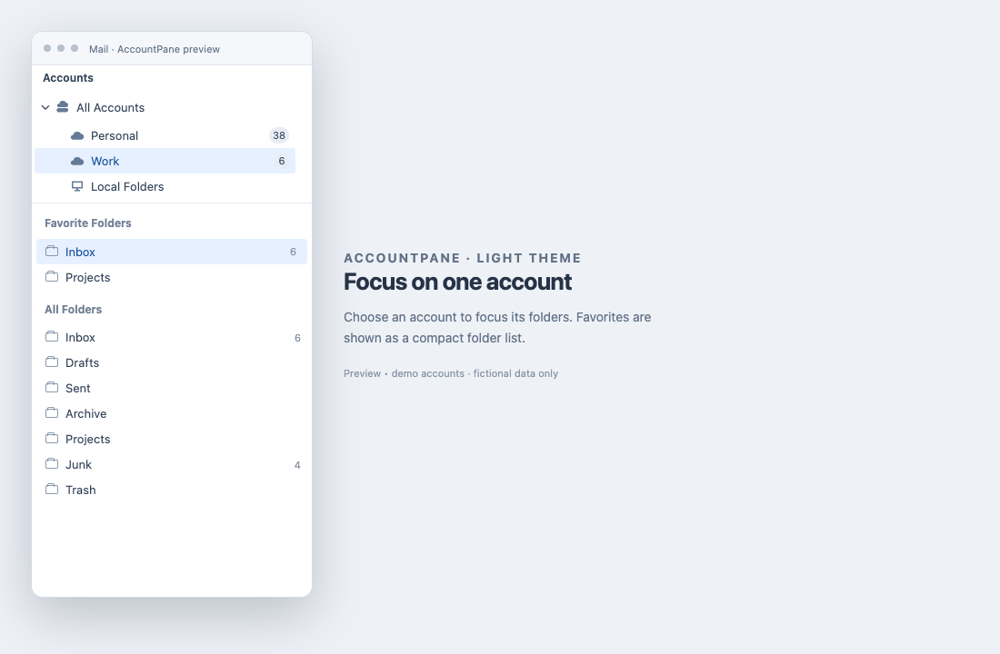
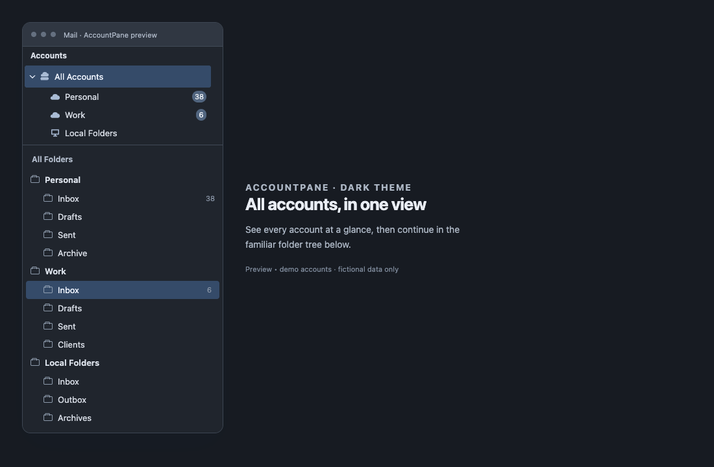

# AccountPane

[English](README.md) · **Русский** · [Возможности](#возможности) · [Скриншоты](#скриншоты) · [Установка](#установка) · [Использование](#использование)

Отдельный список аккаунтов для Thunderbird, вдохновлённый Postbox. Выберите аккаунт в верхней части панели папок — ниже останутся только его папки. Выберите **Все аккаунты**, чтобы вернуться к полному дереву.

AccountPane создан как попытка вернуть привычный способ работы с почтой из Postbox после того, как Postbox перестал обновляться и был заброшен. Расширение добавляет в Thunderbird список аккаунтов в стиле Postbox и работает с вашими существующими аккаунтами и штатными элементами управления папками. Для похожего на Postbox оформления есть тема-компаньон [Thunderbird Tangaroa](https://github.com/stupalov/thunderbird-tangaroa).

**Бета-версия:** требуется **Thunderbird 140 ESR, Betterbird 140 или Thunderbird 157–158**. AccountPane проверен в Thunderbird 157–158 на macOS и в Thunderbird 140 ESR, Betterbird 140 и Thunderbird 158 на Windows 11. Версии 141–156 входят в диапазон манифеста, но не проверялись. Под каждый новый выпуск Thunderbird выходит обновление AccountPane. Изменения внутренних API Thunderbird всё ещё могут потребовать обновления AccountPane.

## Возможности

- **Один аккаунт за раз.** Отдельный список аккаунтов позволяет сосредоточиться на папках выбранного аккаунта. Дублирующий заголовок аккаунта во «Всех папках» скрывается.
- **Группы аккаунтов.** Объединяйте связанные аккаунты в собственные сворачиваемые группы. Свёрнутая группа показывает суммарные счётчики писем и звёздочку новых писем.
- **Счётчики аккаунтов.** Непрочитанные и, если включено в Thunderbird, общее число писем. Спам и его подпапки исключаются из суммы аккаунта.
- **Перетаскивание.** Меняйте порядок аккаунтов мышкой. Порядок сохраняется в самом Thunderbird.
- **Привычные режимы папок.** Все, Избранные, Непрочитанные, Недавние, Объединённые и Метки. При выборе аккаунта подписи вроде «Входящие — Работа» сокращаются до «Входящие».
- **Перенос аккаунтов между группами.** Перетащите аккаунт на заголовок группы или выберите **Переместить в группу** в его меню.
- **Штатные действия.** Правый клик по аккаунту открывает его обычное контекстное меню Thunderbird. Действия с папками остаются в панели папок.
- **Звёздочка новых писем.** У аккаунта появляется штатная звёздочка Thunderbird, пока хоть в одной его папке, кроме Спама, есть новые письма. Свёрнутые «Все аккаунты» показывают её, если она есть хоть у одного аккаунта.
- **Управление с клавиатуры.** Перемещайтесь по аккаунтам стрелками и выбирайте их клавишей Enter или Пробел.

## Скриншоты

Это иллюстративные превью с вымышленными аккаунтами: они используют реальные компоненты и стили AccountPane, отображённые в браузере. Примеры показывают светлое и тёмное оформление и не являются снимками запущенного Thunderbird.

*Светлое оформление: выбран один аккаунт, ниже показаны его папки.*

*Тёмное оформление: «Все аккаунты» показывает полное дерево аккаунтов и папок.*

## Установка

Скачайте последний файл `accountpane-*.xpi` со страницы [Releases](https://github.com/stupalov/thunderbird-account-pane/releases). Если у вас только исходники, воспользуйтесь [инструкцией по сборке](docs/development.md#build-and-test).

1. Откройте Thunderbird → **Дополнения и темы** → **Расширения**.
2. В меню с шестерёнкой выберите **Установить дополнение из файла…**.
3. Выберите XPI, ознакомьтесь с разрешениями и подтвердите установку.
4. Убедитесь, что AccountPane включён. Над деревом папок появится раздел **Аккаунты**.

Для обновления установите новый XPI через то же меню. Предварительно удалять старую версию не нужно.

### Почему при установке запрашивается полный доступ

При установке Thunderbird показывает: «Это дополнение получит полный, неограниченный доступ к Thunderbird и вашему компьютеру». Это не разрешение, которое выбирает AccountPane: у Thunderbird есть только такая формулировка для любого дополнения, использующего Experiment API. AccountPane нужен этот API, потому что штатного WebExtension-интерфейса для изменения панели папок в Thunderbird нет: список аккаунтов можно добавить только кодом, выполняющимся внутри окна Thunderbird, а весь такой код Thunderbird считает полностью доверенным. Любое дополнение для панели папок на Experiment API показывает тот же текст, что бы оно ни делало на самом деле.

Что AccountPane делает с этим доступом на самом деле: читает метаданные аккаунтов и папок (имена, флаги, счётчики, признак новых писем), меняет порядок аккаунтов при перетаскивании и хранит выбранный аккаунт, историю папок и ваши группы аккаунтов в локальном хранилище дополнения. Он не читает содержимое писем и пароли, не выполняет сетевых запросов и не отправляет телеметрию. Исходный код открыт, сборка XPI воспроизводима, поэтому опубликованный файл можно сверить с репозиторием.

## Использование

- **Выберите аккаунт**, чтобы увидеть его папки и открыть первую доступную папку в порядке Thunderbird — обычно «Входящие». При необходимости включается режим «Все папки»; остальные выбранные режимы сохраняются.
- **Выберите «Все аккаунты»**, чтобы показать полное дерево, сохранив текущую открытую папку.
- **Нажмите стрелку рядом с группой**, чтобы свернуть или раскрыть её аккаунты. Выбранный аккаунт и открытая папка не меняются. При свёрнутой группе отображаются суммарные счётчики.
- **Перетащите аккаунт выше или ниже другого**, чтобы изменить порядок. Он изменится в Thunderbird для всех почтовых вкладок, а не только в этой панели.
- **Нажмите правой кнопкой на аккаунт**, чтобы открыть штатное контекстное меню без перехода в другую папку.
- **Нажмите правой кнопкой на заголовок группы** (или клавишу контекстного меню либо Shift+F10 на строке), чтобы открыть меню группы; см. [Группы аккаунтов](#группы-аккаунтов).
- **Используйте клавиатуру:** Вверх/Вниз и Home/End перемещают фокус; Влево/Вправо сворачивают, раскрывают или перемещают между уровнями дерева; Enter/Пробел выбирают аккаунт; Tab переводит фокус к следующему элементу.

При выборе одного аккаунта общие строки режимов «Объединённые» и «Метки», объединяющие разные аккаунты, скрываются. Выберите «Все аккаунты», чтобы вернуть полное представление.

### Группы аккаунтов

**Все аккаунты** — группа по умолчанию. Пока ни один аккаунт не находится в ваших группах, её выбор показывает полное дерево папок, как раньше; когда аккаунты распределены по вашим группам, показываются только папки аккаунтов, оставшихся в ней.

- **Создать группу:** нажмите правой кнопкой на заголовок группы и выберите **Новая группа аккаунтов…** либо выберите **Переместить в группу → Новая группа аккаунтов…** в меню аккаунта — группа будет создана, а аккаунт перенесён в неё.
- **Перенести аккаунт:** перетащите его на заголовок группы либо между аккаунтами другой группы, чтобы перенести и поставить на нужное место. Перетаскивание внутри группы по-прежнему меняет порядок аккаунтов. Пункт **Переместить в группу** в меню аккаунта перечисляет все группы.
- **Выберите группу**, чтобы увидеть папки её аккаунтов. Если аккаунтов несколько, корневая строка каждого аккаунта остаётся в панели папок. Заголовки групп показываются всегда, даже если в группе один аккаунт или ни одного; пустую группу выбрать нельзя.
- **Меню группы:** **Открыть в новой вкладке** и **Открыть в новом окне** открывают первую папку «Входящие» группы (пункт про окно скрыт, если в вашей версии Thunderbird нет нужной штатной функции). **Переименовать…** доступно для любой группы, в том числе для группы по умолчанию; пустое имя возвращает «Все аккаунты». **Удалить** для «Всех аккаунтов» недоступно; пункт возвращает аккаунты группы в «Все аккаунты» и не затрагивает письма.
- **Свёрнутые группы** показывают сумму счётчиков своих аккаунтов и звёздочку новых писем.
- **Клавиатура:** клавиша контекстного меню (или Shift+F10) на строке группы или аккаунта открывает её меню.
- **Ограничения:** «Поиск сообщений…» и «Настройки…» для групп не предлагаются, потому что поиск и настройки аккаунта в Thunderbird работают с одной папкой или одним аккаунтом; пользуйтесь меню аккаунта. Вложенных групп нет, а менять порядок групп пока нельзя.

Группы (имена, порядок, состав, состояние свёрнутости) хранятся локально и общие для всех окон; выбранные группа или аккаунт остаются отдельными для каждой вкладки или окна. Настройки из версий 0.1.x переносятся автоматически. Скрытые аккаунты остаются в своей группе, удалённые исчезают из групп, а новые аккаунты попадают во «Все аккаунты».

### Счётчики писем

Непрочитанные и общее число писем суммируются по папкам аккаунта, за исключением папок, которые Thunderbird определяет как **Спам/Junk**, и всех их подпапок. Важен тип папки: обычная папка с названием «Spam» автоматически не исключается. «Корзина» остаётся в сумме. «Все аккаунты» суммирует отображаемые аккаунты, а показ общего количества зависит от штатной настройки счётчиков панели папок Thunderbird.

Исключение встроено в AccountPane и не имеет отдельного переключателя. Счётчики самих папок, включая «Спам», остаются штатными счётчиками Thunderbird.

### Отключение и удаление

Откройте **Дополнения и темы → Расширения** и отключите AccountPane либо выберите **Удалить** в его меню. Восстановится обычное дерево папок. Изменённый перетаскиванием порядок аккаунтов останется сохранённым в Thunderbird.

## Дополнительно

[История изменений](CHANGELOG.md) · [Разработка](docs/development.md) · [Лицензия](LICENSE)

AccountPane — независимый проект, не официальный продукт Thunderbird или Postbox. Лицензия MIT.
